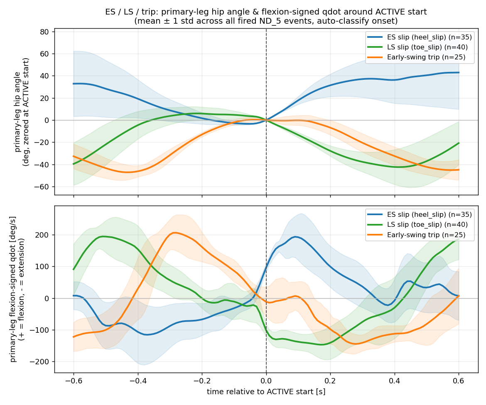
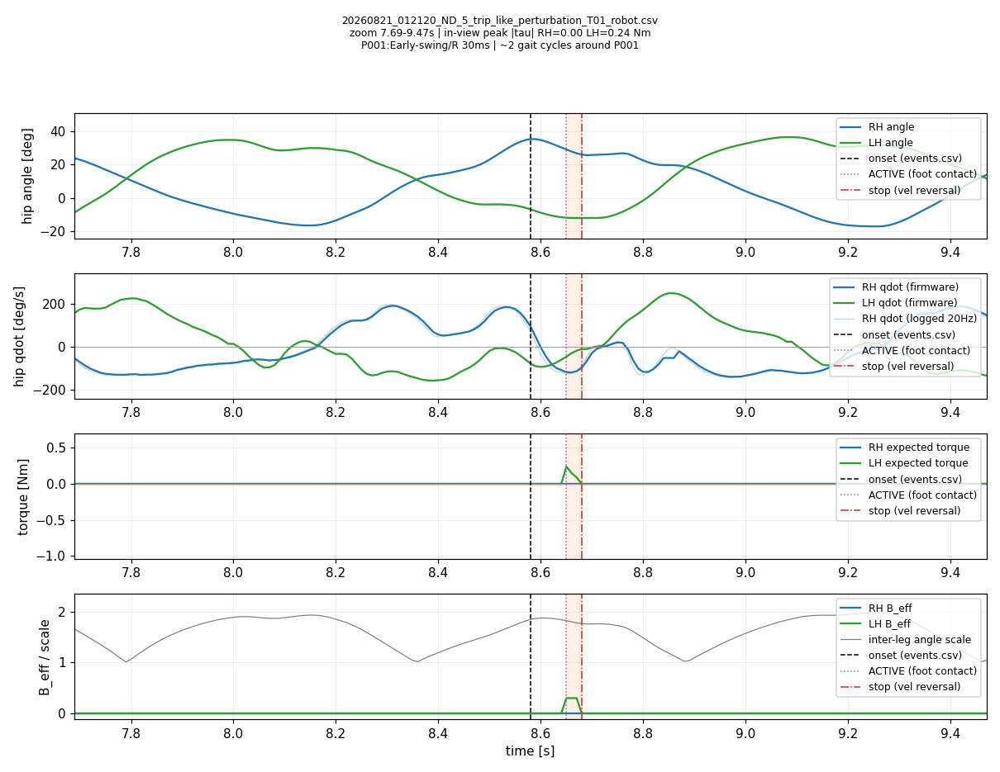

# Perturbation Damping Control for a Hip Exoskeleton (H10 + XM10)

Continuous hip **damping assistance** that reacts to slips and trips during walking, implemented as embedded C firmware for the Angel Robotics **KIT H10** hip exoskeleton (via the **XM10** extension board), plus the PC-side tools used to tune and verify it.

> This repository contains **my part (control)** of a team project for IFAC WRC.
> The full team repository — data-acquisition firmware, EMG logging, and protocol tools — is here:
> [sunji-moon/IFAC-WRC-PerturbationAssistance](https://github.com/sunji-moon/IFAC-WRC-PerturbationAssistance)

## Control idea

When a perturbation is triggered, the controller switches to an ACTIVE state and, every control cycle, commands a hip torque that resists the *current* hip angular velocity:

```
tau(t) = - B_eff * qdot(t)
```

It is continuous viscous damping, not a fixed torque pulse: the faster the hip moves in the harmful direction, the more it is resisted, and the torque fades as the motion slows.

Each perturbation type uses a different leg/direction assignment:

| Perturbation | Perturbed leg | Stance leg | Start | Stop |
|---|---|---|---|---|
| **ES slip** (early-stance / heel slip) | damp hip **flexion** | damp hip **extension**, scaled by inter-leg angle | immediately | perturbed-leg hip velocity changes sign after its peak |
| **LS slip** (late-stance / toe slip) | damp hip **extension** | damp hip **flexion**, scaled by inter-leg angle | immediately | same rule, opposite direction |
| **Early-swing trip** | damp hip **flexion**, scaled by COM velocity | damp hip **extension** | waits until the tripped foot touches the ground again | same rule |

Implementation details (in `firmware/damping_assist.c`):
- Hip velocity is computed from the H10 encoder angle and low-pass filtered (15 Hz). After the velocity peak, a separate 4 Hz filtered velocity is used, so the commanded torque does not chatter near zero velocity.
- There is no fixed assistance duration; the controller stops on velocity reversal.
- Each leg is damped in one direction only (e.g. flexion for the impact leg); in the other direction its torque is zero. Positive and negative velocity are filtered as separate rectified envelopes and then recombined, so sensor noise does not flip the torque sign.
- All gains (`g_k_es_impact`, `g_k_ls_slip`, `g_k_trip_impact`, ...; units N·m·s/rad) are `volatile` globals, so they can be tuned live from STM32CubeIDE Live Expressions.
- For bench testing, perturbations are triggered manually with the XM buttons (BTN_1 = ES slip, BTN_2 = LS slip, BTN_3 = trip; event side set by `g_manual_event_side`).

## Repository layout

```
firmware/
  damping_assist.c          Final controller (2026-08-26): ES/LS slip + trip, rectified torque
  damping_assist_dryrun.c   Same controller with motor output forced to 0 Nm, for safe dry runs
  archive/                  Earlier iterations, kept for reference
    damping_assist_detector_triggered.c   First version, triggered by an external detector
    damping_assist_threshold_stop.c       Button-triggered, stop on threshold-confirmed reversal
    damping_assist_click_trigger.c        Short-click trigger, impact/stance gain retuning
    damping_assist_es_only.c              ES-slip-only variant
    user_app_last_flashed.c               File that was last built on the board
pc_tools/
  damping_tuning_gui.py     Tkinter GUI: tune damping gains and preview the torque waveform on recorded data
  csv_torque_pipeline.py    Offline replay of the firmware state machine on recorded trials
                            -> "what torque would H10 have commanded?" before putting torque on a person
  damping_live_logger.py    Live USB-CDC logger for the damping firmware stream
  xm_daq_protocol.py        Packet decoder shared with the team DAQ tools (team code, see below)
results/figures/            Example outputs of the tools above
```

## Results (offline replay on recorded perturbation trials)

Average hip angle and velocity around the controller start, for the three perturbation types. They show clearly different velocity patterns, which is why each type gets its own leg/direction rule:



Expected torque for one trip event: the controller waits for foot contact, applies damping, and stops when the velocity reverses:



## How to use

**Firmware.** Built in STM32CubeIDE on the XM10 SDK version used by the team in summer 2026, which calls the entry points `User_Setup()` / `User_Loop()`. Copy `firmware/damping_assist.c` (or `damping_assist_dryrun.c` together with it) into the SDK's user-algorithm folder as the only user application, then build and flash. Newer SDK releases (v2.6.0+) rename the entry points to `Control_Setup()` / `Control_Loop()`.

> ⚠️ This firmware commands torque to a wearable robot. Start with the dry-run build, then low gains, with the emergency stop ready.

**PC tools.**
```
pip install -r requirements.txt
python pc_tools/damping_tuning_gui.py
python pc_tools/csv_torque_pipeline.py --batch <folder of robot CSVs> --outdir torque_png
python pc_tools/damping_live_logger.py
```
Raw experiment data is not included.

## Credits

- **Control design and implementation (this repository):** Sunji Moon — damping controller firmware, tuning GUI, offline torque replay pipeline, damping stream logger.
- **Team:** _(add team member names)_ — perturbation experiments, data-acquisition firmware, EMG logging, `xm_daq_protocol.py`. See the [team repository](https://github.com/sunji-moon/IFAC-WRC-PerturbationAssistance).
- **Platform:** KIT H10 and XM10 SDK by Angel Robotics. The SDK itself is not included here.
